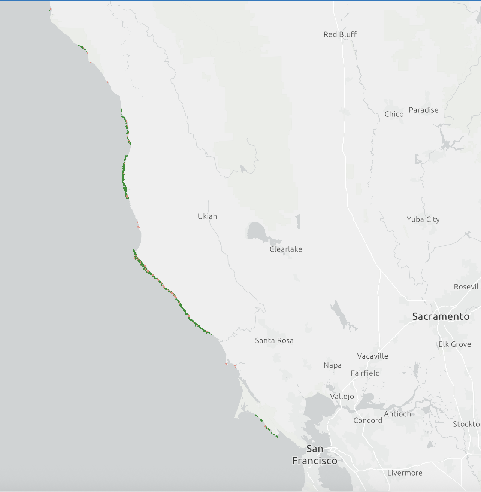
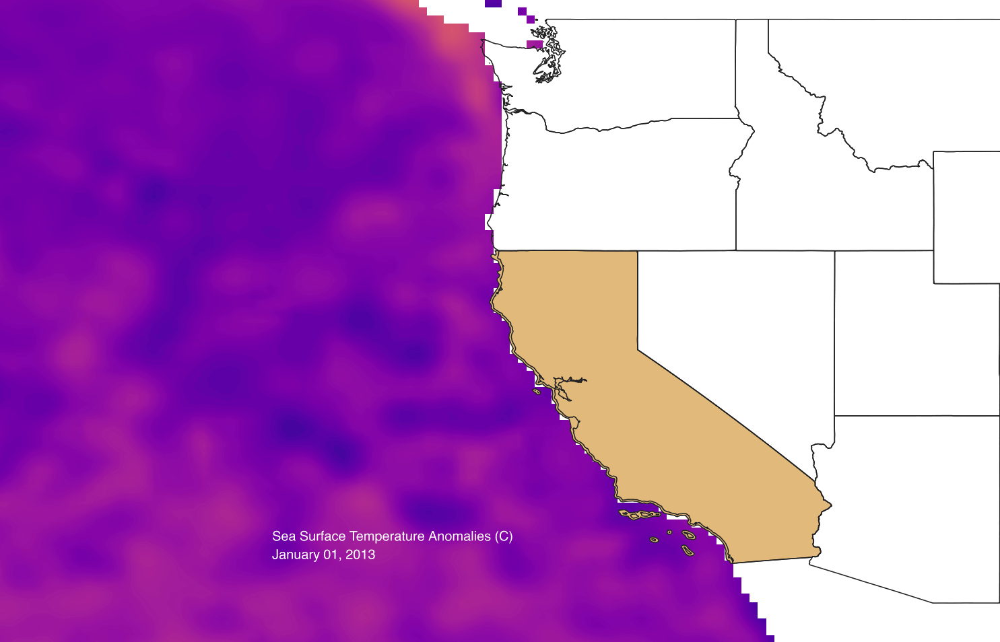

# The Vanishing Forests
### Decline of Bull Kelp Forests on the California North Coast

**[View the StoryMap](https://storymaps.arcgis.com/stories/d6ea87d420ce4c45b23746d422b7c8b2)** 

## Overview
Between 2013 and 2019, more than 95% of the bull kelp forests along California's North Coast disappeared, replaced by urchin barrens. This project maps the decline of kelp canopy and links it to the climate-driven stressors behind the collapse.

## Maps

### Kelp Canopy Decline, 2008 vs. 2017
Interactive web map comparing kelp canopy extent in 2008 (green) and 2017 (red) along the Sonoma and Mendocino coast. Click the image above to open the live map.

### Sea Surface Temperature Anomalies, 2013–2016

Animated sea surface temperature anomalies along the U.S. West Coast during the northeast Pacific marine heatwave known as "The Blob," which raised temperatures 2–3 °C above average along the California Current.

## Key Findings
- **Multiple stressors at once:** The marine heatwave pushed bull kelp past its thermal tolerance, while weaker upwelling cut nutrient supply.
- **Loss of a key predator:** Sea star wasting disease nearly eliminated sunflower sea stars, allowing purple urchin populations to explode and strip reefs bare.
- **Limited refuges:** Colder, deeper, or more sheltered reefs held on longer, but these refuges are shrinking as warming continues.
- **Recovery is possible:** Urchin removal has allowed kelp to reestablish in cleared areas, and sunflower sea star recovery and Marine Protected Areas could help restore balance.

## Tools
ArcGIS Online, ArcGIS StoryMaps, GIMP

## Key References
- Rogers-Bennett, L., & Catton, C.A. (2019). Marine heat wave and multiple stressors tip bull kelp forest to sea urchin barrens. *Scientific Reports*, 9, 15050.
- Bond, N.A., et al. (2015). Causes and impacts of the 2014 warm anomaly in the NE Pacific. *Geophysical Research Letters*, 42(9), 3414–3420.
- Harvell, C.D., et al. (2019). Disease epidemic and a marine heat wave are associated with the continental-scale collapse of a pivotal predator (*Pycnopodia helianthoides*). *Science Advances*, 5(2), eaau7042.

Full literature cited is in the StoryMap.

## Author
**Ori Gal**, Ecology & Evolutionary Biology, University of Colorado Boulder · April 2026
